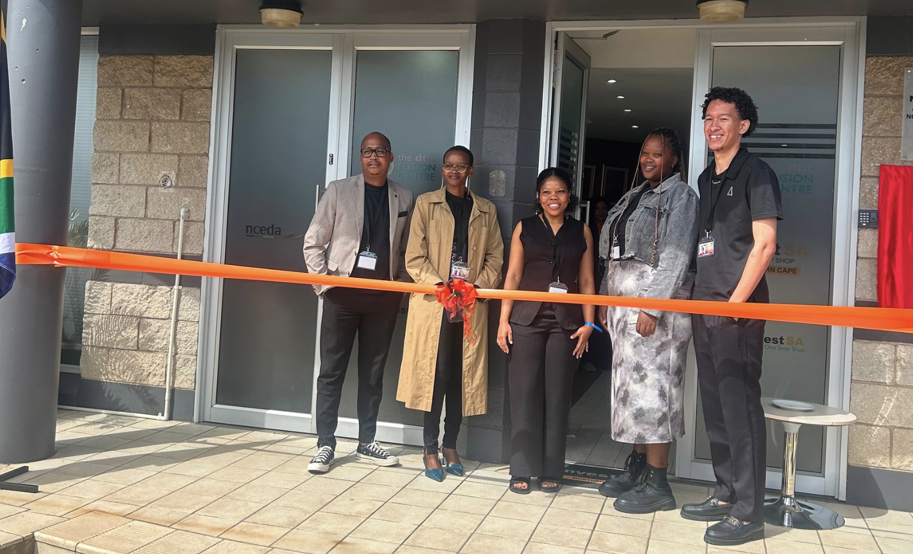

Four graduates used their software development skills to build a digital platform that supports investment promotion and helps investors access important business information.

Digital skills create meaningful opportunities when they are used to solve real challenges. For four graduates of mLab’s CodeTribe Software Development programme, that opportunity came through developing a website for the Northern Cape Economic Development, Trade and Investment Promotion Agency (NCEDA), for InvestSA’s One Stop Shop.

The project highlights how young South African developers can apply their skills to professional projects while contributing to digital solutions that support investment and economic development.

## Making investment information more accessible

InvestSA’s One Stop Shop helps investors navigate the processes involved in establishing and operating a business in South Africa. These can include company registration, tax registration, permits, licences and other government approvals.

The website provides an online platform where investors can learn about the available services and find information to help them navigate the investment process. By bringing relevant information together in one place, the platform supports InvestSA’s work to make it easier for investors to understand the requirements involved in doing business in South Africa.

Explore the website: <https://www.investsa.gov.za/one-stop-shop/>

Through their work on the website, CodeTribe graduates Hanna Sebolai, Felicia Tlhareseng, Muhammed Davids and Galaletsang Morokonyana helped bring this service to an online audience.

Their contribution demonstrates how software development goes beyond writing code. Digital platforms can help organisations communicate more effectively, make information easier to access and connect people with services that meet their needs.

## A professional project with real impact

The value of the project extends beyond the website itself. It also reflects the opportunities created when young developers are given the chance to apply their training in a professional environment.

Jessica Makgetla, Assistant Director for Trade and Investment Promotion at the Northern Cape Department of Economic Development and Tourism, shared positive feedback about the graduates’ work, describing the platform as functional and professionally developed. 

She also praised the quality of their work as impeccable.

“The CodeTribe graduates created a functional platform that meets our needs in a professional manner. The quality of their work is impeccable, and we appreciate the contribution they have made to our work.”

## Turning digital skills into opportunity

For mLab, this project reflects the purpose of the CodeTribe Software Development programme: equipping young people with practical digital skills they can use to contribute to the economy and build their careers.

The project also shows the connection between digital skills development and enterprise development. While graduates gain professional experience and demonstrate their capabilities, organisations can access the skills needed to develop digital solutions that support their work.

Organisations who want digitally skilled talent can express interest here: <https://survey.zohopublic.eu/zs/grBxVM>, and we will get in touch. 

In the Northern Cape, where digital skills can help open doors to new opportunities, projects like this demonstrate the value of investing in local talent and creating pathways for young people to participate in the digital economy.

At mLab, success is not only about the skills young people acquire during training. It is also about what they can do with those skills, the opportunities they access and the value they create for others.

The work of these four graduates is a reminder that when young people are equipped with the right skills and given opportunities to apply them, they can develop practical solutions that make a meaningful difference.