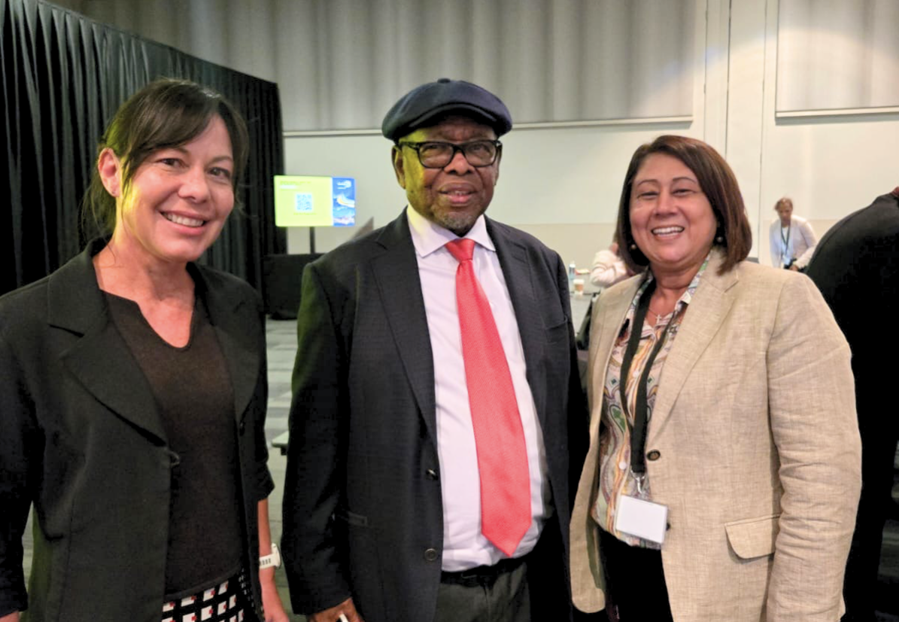
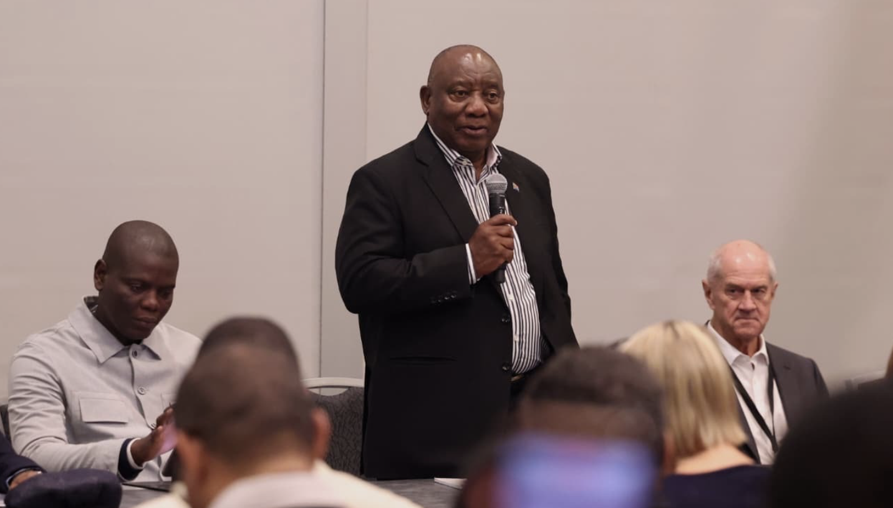

South Africa's digital innovation ambitions are taking centre stage in Silicon Valley, with mLab CEO Nicoli Koorbanally joining [President](https://www.linkedin.com/posts/governmentza_sainusa-sainusa-betterafricabetterworld-activity-7528928881978949632--K_I?utm_source=share&utm_medium=member_desktop&rcm=ACoAAC73LsQBwAlhbz_-MEm7h1wbN0vNkWwd9gg) Cyril Ramaphosa's high-level delegation to the United States of America from 15 to 21 November 2026.

The mission, which includes [Minister](https://www.linkedin.com/posts/dept-of-science-and-innovation_sainusa-scienceforsocialjustice-dsti-activity-7528005707535872001-jOlG?utm_source=share&utm_medium=member_desktop&rcm=ACoAAC73LsQBwAlhbz_-MEm7h1wbN0vNkWwd9gg) of Science, Technology and Innovation Prof. Blade Nzimande, brings together leaders from government, research institutions, industry and the innovation ecosystem to explore advances in Artificial Intelligence (AI), strengthen international collaboration and identify new opportunities for South Africa's AI economy.

For mLab, the visit presents an opportunity to connect South African innovation and talent with one of the world's leading technology ecosystems. At the heart of mLab's participation is a clear ambition: to turn global learning and connections into meaningful opportunities for South Africa’s young people, start-ups, small enterprises and vulnerable communities; in pursuit of advancing “AI for All’.

Drawing from the immersed experience in Silicon Valley, the mission compels the critical review of our digital skills and enterprise development offerings. Whilst contemplating the rapid pace of technological change, the risks and its associated opportunities, it will be critical to translate the learnings into action. It is evident that a mindshift change is needed, and fast. Conceptualising interventions that are contextual, yet internationally competitive will help build the innovation capability necessary for South Africa to pivot from consumer to producer of technology, and AI in particular, that can be leveraged to tackle youth unemployment and foster sustainable economic growth. The mission also explores opportunities to connect local start-ups and young digital talent with international markets, investment, partnerships and income-generating opportunities.

Speaking on the significance of the mission, mLab CEO Nicoli Koorbanally said:

“South Africa boasts exceptional talent and innovation potential, making us a prime destination for AI investment and a lucrative hub for emerging tech talent. This mission is about accelerating our capacity to build a thriving AI economy; one that is sector agnostic and with the potential to unlock unimaginable possibilities for South Africans, particularly those facing poverty and inequality . The consistent message throughout the mission was that speed and agility are imperative if we are to compete globally, and firmly position South Africa as a leading innovation partner on the African continent.”

Koorbanally brings more than two decades of experience in research, development and innovation to the delegation. She also serves on the Advisory Board of the South African Artificial Intelligence Association and has extensive experience in translating innovation into commercial and societal value. Her participation in the mission affirms mLab's commitment to bridging the gap between digital skills development, entrepreneurship and meaningful economic participation.

We cannot afford to be left behind, and mLab is resolute in its vision of building Africa’s digital future. By advancing skills in 4IR technologies and democratising digital entrepreneurship, mLab will work with various ecosystem partners to collaboratively establish South Africa as a premier destination for AI investment and a trusted supplier of emerging AI talent while creating inclusive opportunities for young people and women who have historically faced barriers to participation in the digital economy.

The mission is not simply about learning from Silicon Valley. It is about showcasing South Africa’s rich diversity and talent, and collectively shaping our approach to the ethical creation, use and adoption of AI. Inclusive learning and mutually beneficial partnerships can build stronger South African enterprises, creating pathways to employment and sustainable growth.

**MEDIA ENQUIRIES**

**Zukanye Madakana**

**Email**: zukanye@mlab.co.za 

**Phone:** 071 097 8947